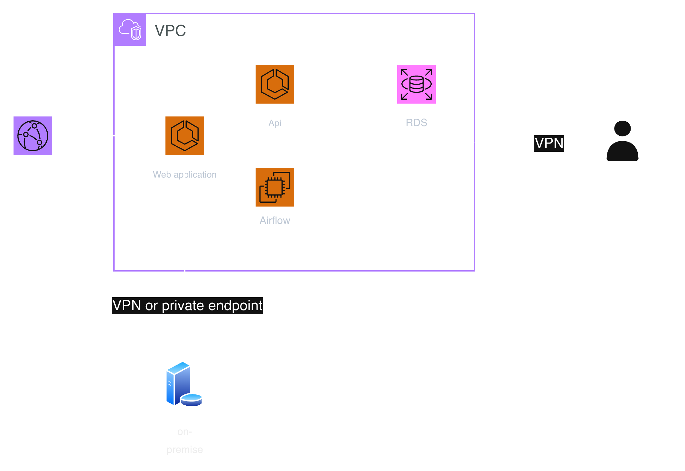

# Architecture Demo สำหรับ Web Application

## ภาพรวม
Architecture นี้ออกแบบสำหรับ Web Application ที่ใช้งานภายในองค์กร
ใช้ AWS เป็น Cloud Provider โดยมี service หลักดังนี้

- **ECS:** รัน Web application และ API (container)
- **EC2:** รัน Airflow สำหรับงาน data pipeline
- **RDS:** ฐานข้อมูลหลัก
- **CloudFront:** เป็นจุดเข้าของ user และใช้กำหนดกฎการเข้าถึง เช่น จำกัด IP ของออฟฟิศ บังคับ HTTPS 

## หลักการทำงาน
1. **CloudFront:** user เข้าใช้งานผ่าน CloudFront ก่อน
   โดยมีกฎกำหนดว่าใครเข้าได้บ้าง
2. **VPC:** เป็นเครือข่ายส่วนตัวที่แบ่ง IP ให้ทุก service และใช้
   Security Group กำหนดว่า IP/Port ไหนเข้าถึงอะไรได้
3. **Web application (ECS):** เป็นจุดติดต่อระหว่าง user กับ service อื่น
4. **API (ECS):** รับคำขอจาก Web application และอ่าน/เขียนข้อมูลกับ RDS
5. **Airflow (EC2):** [ระบุหน้าที่ เช่น ตั้งเวลาและควบคุม data pipeline]
6. **On-premise:** [Web application / Airflow] เชื่อมต่อผ่าน VPN หรือ
   Private endpoint เพื่อให้ข้อมูลไม่ผ่าน public internet
7. **Develop Team:** เข้าถึง URL หรือฐานข้อมูลได้ผ่าน VPN ที่เตรียมไว้เท่านั้น

## เหตุผลการออกแบบ
- โจทย์ไม่ได้ระบุว่า user เข้าถึงจากที่ใด (เช่น เฉพาะออฟฟิศ หรือต้องได้รับ
  อนุญาตก่อน) จึงออกแบบเส้นทางของ user ไว้อย่างกว้าง ๆ และต้องกำหนดเพิ่ม
  เมื่อทราบความต้องการ
- โจทย์ไม่ได้ระบุรูปแบบการ deploy จึงเลือก ECS (container) เพราะ scale ง่าย
  ไม่ต้องดูแล OS และ deploy ได้รวดเร็วกว่า EC2
- Airflow ใช้ EC2 เพราะต้องตั้งค่าและติดตั้ง component เพิ่มเองหลายส่วน
  การใช้ EC2 จึงสะดวกและควบคุมได้อิสระกว่า

## CI/CD pipeline [pipeline.md](./pipeline.md)