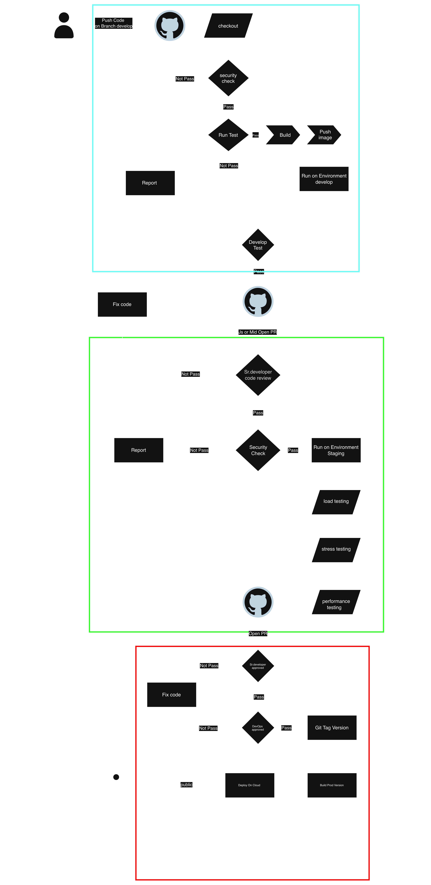

# การออกแบบ CI/CD Pipeline

แบ่ง environment ตามสีของกรอบในภาพ

- สีฟ้า: Dev
- สีเขียว: Staging
- สีแดง: Prod

## Dev (กรอบสีฟ้า)
เมื่อ developer push code ขึ้น branch `develop` GitHub Actions
จะทำงานตามลำดับดังนี้

1. **Checkout:** ดึง code ล่าสุดจาก repository
2. **Security Check:** ตรวจ SQL Injection, Key/Password ที่ฝังใน code
   และ library ที่ต้องอัปเดต
   ถ้าไม่ผ่านจะส่ง Report ไปยัง developer 
3. **Run Test:** รัน test ที่ทีม Tester เขียนไว้ และ smoke test
   เพื่อตรวจว่าระบบทำงานถูกต้อง ถ้าไม่ผ่านจะส่ง Report
4. **Build:** build เป็น image
5. **Push image:** push image ไปยัง container registry [เช่น ECR]
6. **Run on environment develop:** deploy ลง Dev เพื่อให้ developer ทดสอบ
7. **Develop Test:** ถ้าไม่ผ่านให้ Fix code แล้ว push ใหม่
   ถ้าผ่านให้ Jr. หรือ Mid developer เปิด PR เพื่อให้ Sr. Developer รีวิว

## Staging (กรอบสีเขียว)
1. **Sr. Developer Code Review:** รีวิว code เบื้องต้นว่าถูกต้องหรือไม่
   ถ้าไม่ผ่านให้ส่ง Report กลับไปยัง developer
2. **Security Check:** ตรวจอีกรอบเช่น image scan, DAST
   เพื่อให้แน่ใจว่าไม่มีข้อมูลหลุดหรือช่องโหว่
3. **Run on environment staging:** deploy เพื่อทดสอบ โดยทีม Tester
   ทดสอบเพิ่มดังนี้
   - **Load testing:** ทดสอบการรับโหลดปกติ
   - **Stress testing:** ทดสอบเมื่อโหลดเกินปกติ
   - **Performance testing:** วัดเวลาตอบสนองและการใช้ resource

หากผ่านทั้งหมด จึงเปิด PR เพื่อขึ้น Prod

## Prod (กรอบสีแดง)
1. **Sr. Developer Approved:** ตรวจสอบรอบสุดท้าย
   ถ้าไม่ผ่านให้ Fix code
2. **DevOps Approved:** ตรวจสอบ environment variables และ config
   ของ server ว่าพร้อมใช้งาน ถ้าไม่ผ่านให้ Fix code
3. **Git Tag Version:** ติด Git Tag เพื่อระบุเลข version ที่ชัดเจน
4. **Build Prod Version:** build (หรือ promote image จาก Staging) สำหรับ Prod
5. **Deploy On Cloud:** deploy ให้ user ใช้งาน และตรวจด้วย smoke test

## การเก็บ configuration , secret configuration, secret และการเชื่อมต่อกับระบบภายนอก
1. configuration จะเก็บไว้ภายนอก Project เช่นถ้าใช้ kube จะเก็บไว้ใน configmap หรือ deploymaet.yaml
2. secret หากต้องใช้ตอน build จะเก็บในส่วน secret ของแต่ละ ci/cd เจ้าที่ใช้โดยให้ dev เพื่อผ่าน env เท่านั้นหรืออาจจะเก็บแบบ secret ใน cloud แต่ละเจ้าก็ได้
3. ถ้าเป็น Private endpoint ก็ผ่าน env และเข้ารหัสไว้

## แนวทางการดูแลเสถียรภาพของระบบ 
1.  ใช้ service ของ cloud หรืออาจะติดตั้งเองในการทำ dasebord ในการ monitoring cpu ram network loging ก็ได้
2.  การจัดเก็บ loging ในปัจจุบันอาจจะยังไม่พอในการดูแลระบบหากระบบมีการโตขึ้นเรื่อยๆ ให้ทำการทำ observability ในการตรวจสอบในละเอียดขึ้น
3.  มีการทำ Uptime เพื่อให้รู้ว่าระบบยังรันอยู่หรือไม่

## ส่วนการจัดการ version 
1. Dev จะใช้เลข commit มาทำการเข้ารหัส ไว้และเอามาแค่ 4ตัวหน้าเพราะเป็น version ที่ไม่ต้องการให้ลูกค้าใช้งานหรือไม่จำเป็นต้องเก็บ
2. Staging จะใช้  github.run_number:เลขcommit ใช้หลัการเหมือนกับ dev
3. Prod ต้องการเลขversion ที่ชัดเจนจำเป็นต้องกำหนดในรูปแบบ MAJOR.MINOR.PATCH 
   * MAJOR = จะเก็บเลขไว้ใน env ของ ci/cd
   * MINOR = จะเอา github.run_number มาใช้
   * PATCH = เลขcommit เหมือนกับ Staging
